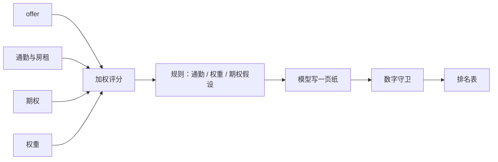

# Shortlist · offer comparison

[](https://github.com/wushiyi105-jpg/shortlist/actions)

[](./LICENSE)


Three offers flattened into one table: annualised pay, hourly rate, commuting cost, equity in three scenarios.

## Features

- Annualises base plus bonus instead of multiplying a monthly figure by 12.
- Prices commuting time at half your hourly rate and adds the rent difference.
- Values equity under three exits (zero, half price, preferred price) and averages them as a reference.
- Weights pay, growth and cost; weights that do not sum to 1 raise `weights.sum`.

Rules live in `shortlist/domain/rules/`; the CLI and the web layer only call them. The Chinese README lists every `rule_id` with its penalty.

## Quickstart

```bash
pip install -e ".[dev]"
python -m shortlist seed
python -m shortlist board
python -m shortlist note
python -m shortlist serve        # http://127.0.0.1:8006
```

Run `python -m shortlist --help` for the full command list; `docker build -t shortlist . && docker run -p 8006:8006 shortlist` works the same way.

## Why not just ask a general LLM

A 20k monthly salary with a 40k bonus and a 22k salary paid 14 times are not comparable until annualised, and an 80-minute commute is worth more than a hundred hours a year. Shortlist converts each item to money and lets you rank with your own weights.

## When to use it

- You hold several offers that look similar on monthly pay.
- A role is in another city and rent and commuting change the maths.

## Roadmap

- Model equity after dilution instead of face value.
- Compare take-home pay after tax.

## FAQ

**How is equity valued?**
Three exit scenarios averaged; it is a reference, not a promise.

**Do the weights have to sum to 1?**
Yes, otherwise the score is rejected.

## Commands

See the Chinese README (`README.md`) for the command table with flags; every command supports `--help`.

## Dependencies

FastAPI + Uvicorn, Jinja2, pydantic / pydantic-settings, httpx, Typer + Rich, SQLAlchemy + Alembic; dev extras add pytest, pytest-cov, respx, freezegun, ruff, mypy, pip-audit. Version pinning lives in `uv.lock`.

## How it works



## Layout

```
shortlist/
├── .github/
│   ├── ISSUE_TEMPLATE
│   ├── PULL_REQUEST_TEMPLATE.md
│   └── workflows
├── assets/
│   └── demo.gif
├── data/
│   ├── seed.json
│   └── shortlist.db
├── migrations/
│   ├── __init__.py
│   ├── env.py
│   ├── script.py.mako
│   └── versions
├── prompts/
│   └── note.md
├── shortlist/
│   └── … 9 项
├── templates/
│   └── index.html
├── tests/
│   ├── __init__.py
│   ├── conftest.py
│   ├── test_comp.py
│   ├── test_equity_score.py
│   ├── test_guard_engine.py
│   └── test_web_cli.py
├── CHANGELOG.md
├── CODE_OF_CONDUCT.md
├── CONTRIBUTING.md
├── Dockerfile
├── LICENSE
├── README.en.md
├── README.md
├── SECURITY.md
├── alembic.ini
├── pyproject.toml
```

## Author

shiyi · GitHub [@wushiyi105-jpg](https://github.com/wushiyi105-jpg) · wushiyi105@gmail.com
