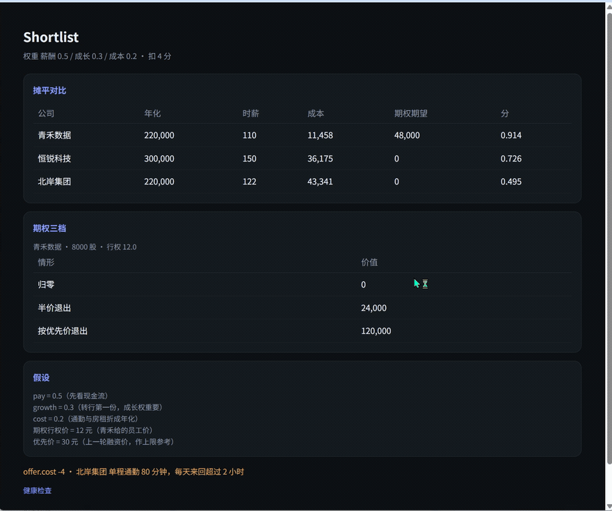
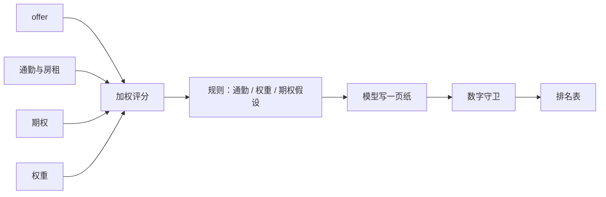

# Shortlist · offer 对比

[](https://github.com/wushiyi105-jpg/shortlist/actions)

[](./LICENSE)



三个 offer 摊平成一张表：年化、时薪、通勤与房租成本、期权三档。


## 功能特性

1. **年化**：底薪 + 奖金，不当成月薪乘 12。
2. **时薪**：按每周实际工作天数折算工时。
3. **成本**：通勤时间按本人时薪折半计价，加房租差。
4. **期权三档**：归零、半价退出、按优先价退出，取均值只作参考。
5. **加权排名**：薪酬 / 成长 / 成本三项，权重不凑满 1 就报警。

### 规则与扣分

| rule_id | 含义 | 扣分 |
| --- | --- | --- |
| `offer.cost` | 单程通勤 > 60 分钟 | 4 |
| `weights.sum` | 权重合计不等于 1 | 6 |
| `equity.assumption` | 有期权没行权价 | 3 |
| `equity.strike_high` | 行权价 ≥ 优先价，三档全 0 | 5 |
| `guard.number` | 模型稿里出现输入没有的数 | 8 |

## 快速开始

```bash
pip install -e ".[dev]"
python -m shortlist seed
python -m shortlist board
python -m shortlist note
python -m shortlist serve        # http://127.0.0.1:8006
```

真实种子：恒锐（26 万 + 4 万奖金、单程 55 分钟、房租 +1800）、青禾（22 万、单程 25 分钟、8000 股期权
行权价 12、优先价 30）、北岸（19.5 万 + 2.5 万、四天半、单程 80 分钟、房租 +2600）；权重 0.5 / 0.3 / 0.2。

`board` 出来：青禾年化 22 万、时薪 110、成本 11,458、期权期望 48,000、分 0.914 排第一；恒锐年化 30 万
但时薪 150 只高 40 块、成本 36,175，分 0.726；北岸年化也是 22 万，成本 43,341 最高，分 0.495。
北岸单程 80 分钟，判一条 `offer.cost`，合计扣 4 分。

## 为什么不用通用大模型直接问

月薪 2 万加 4 万年终和月薪 2.2 万十四薪，谁高要看年化；单程 55 分钟和 25 分钟，一年差出一百多个小时；
期权写「8000 股」不写行权价，等于什么都没说。Shortlist 把这几项都换成钱，再按你自己定的权重排名。

## 适用场景

- 手上同时有两三个 offer，月薪看起来差不多，年化其实差不少。
- 异地岗位，要把通勤时间和房租差折成钱再比。
- offer 里有期权，但只写了股数没写行权价。

### 边界

- 期权按面值粗算，不建模稀释与税；
- 成长分是自己打的，不是模型给的；
- 不替代和家人商量。

## Roadmap

- 期权按稀释后股本建模，不再只用面值。
- 税后到手对比（个税与社保口径）。
- 城市生活成本库，房租差不用手填。

## FAQ

**期权期望怎么算？**
归零 / 半价退出 / 按优先价退出三档取均值，只作参考。

**权重必须加起来等于 1 吗？**
必须，不等于 1 会报 `weights.sum`。

**成长分谁打？**
自己打，工具不给建议。

**Docker 镜像验证了吗？**
本机没有 Docker，`docker build .` 未执行，镜像未构建验证；Dockerfile 与端口只做了静态核对。

## 命令参考

| 命令 | 作用 | 常用参数 |
| --- | --- | --- |
| `seed` | 写入 offer 与权重假设。 | --db |
| `board` | 摊平表与扣分。 | --db |
| `note` | 模型写一页纸（无 key 时打印假设）。 | --db |
| `doctor` | 四项体检。 | --db |
| `serve` | Web 界面。 | --port, --db |

全部命令都支持 `--help`；只读命令不带参数时读默认库 `data/shortlist.db`，写命令用 `--db` 指到别的库。

## 依赖说明

| 依赖 | 为什么装 | 不装会怎样 |
| --- | --- | --- |
| `fastapi` + `uvicorn[standard]` | Web 入口与 ASGI 服务 | 只有命令行，没有页面 |
| `jinja2` | 服务端渲染模板 | 页面出不来 |
| `pydantic` + `pydantic-settings` | 配置与数据结构校验，`.env` 直接生效 | 配置散在代码里，改端口要改源码 |
| `httpx` | 调模型与 webhook 的 HTTP 客户端 | 模型层与推送都不可用 |
| `typer` + `rich` | 命令行与终端表格 | 只能用 curl 调接口 |
| `sqlalchemy` + `alembic` | 本地库与迁移 | 表结构变更只能删库重来 |
| `pytest` / `pytest-cov` / `respx` / `freezegun`（dev） | 单测、覆盖率、HTTP 打桩、冻结时间 | 规则改动没有回归保护 |
| `ruff` / `mypy` / `pip-audit`（dev） | 风格、类型、依赖漏洞检查 | CI 只看测试，类型错误会漏进主干 |

装了 `uv` 的话，`uv sync --extra dev` 会按 `uv.lock` 装同一套版本。

## 工作原理




domain 里是年化、时薪、成本、期权三档与加权评分；app 负责排名表。

## 目录结构

```
shortlist/
├── .github/
│   ├── ISSUE_TEMPLATE
│   ├── PULL_REQUEST_TEMPLATE.md
│   └── workflows
├── assets/
│   └── demo.gif
├── data/
│   ├── seed.json
│   └── shortlist.db
├── migrations/
│   ├── __init__.py
│   ├── env.py
│   ├── script.py.mako
│   └── versions
├── prompts/
│   └── note.md
├── shortlist/
│   └── … 9 项
├── templates/
│   └── index.html
├── tests/
│   ├── __init__.py
│   ├── conftest.py
│   ├── test_comp.py
│   ├── test_equity_score.py
│   ├── test_guard_engine.py
│   └── test_web_cli.py
├── CHANGELOG.md
├── CODE_OF_CONDUCT.md
├── CONTRIBUTING.md
├── Dockerfile
├── LICENSE
├── README.en.md
├── README.md
├── SECURITY.md
├── alembic.ini
├── pyproject.toml
```

## 作者

大钊 · GitHub [@wushiyi105-jpg](https://github.com/wushiyi105-jpg) · 17382987315
